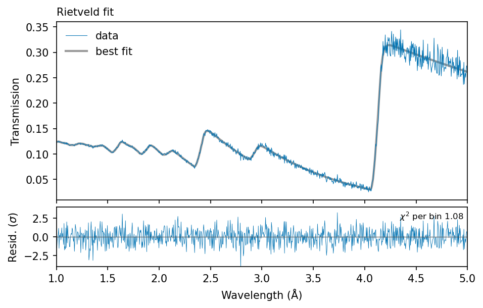
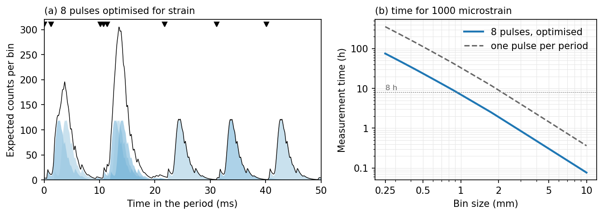

# frame_overlap

**Bragg-edge imaging with programmable, overlapping neutron pulses, on top of [nbragg](https://github.com/TsvikiHirsh/nbragg).**

At a continuous source with a fast chopper, such as SARAF-II, several pulses per period bring more
neutrons, but their spectra overlap. frame_overlap fits the overlapped counts directly: nbragg's
transmission model is convolved with the pulse pattern and compared with the counts (a Rietveld fit
of the counts). It also plans the pulse pattern and the measurement time for a sample, a precision
and a spatial resolution.

## Quick example

Fit a measurement with four overlapping pulses per period, as you would fit one spectrum in nbragg:

```python
import nbragg
import frame_overlap as fo

xs = nbragg.CrossSection(iron="Fe_sg229_Iron-alpha.ncmat")                           # define sample
pattern = fo.Pattern([0, 11.97e-3, 22.33e-3, 35.48e-3])                               # pulse times [s]
model = fo.TransmissionModel(xs, pattern=pattern, vary_basic=True, vary_strain=True)  # define model
data = fo.Data.from_counts("sample.csv", "openbeam.csv", pattern=pattern, time=8 * 3600)  # read data
result = model.fit(data)                                                              # perform fit
result.plot()                                                                         # plot results
```



The plot shows the transmission recovered from the overlapped counts, the fitted model and the
residuals in units of their standard deviation. `result.params` holds the fitted values and errors
as lmfit Parameters, and `print(result.fit_report())` summarises the fit.

## Plan a measurement

Give the sample and say what you want to measure. `fo.plan` optimises the pulse times and tells you
the precision and the measurement time for any bin size:

```python
plan = fo.plan(xs, thickness=2.0, target="strain", n_pulses=[1, 2, 4, 8, 12],
               instrument=fo.Instrument.saraf_ii())
print(plan.summary(strain=1000))                   # pulse times, gains, hours for 1000 microstrain
plan.time_for(bin_size=1.0, strain=1000) / 3600    # hours for 1000 microstrain in 1 mm bins
plan.plot(strain=1000)
```



`plan.model` carries the chosen pattern: `plan.model.fit(data)` fits a measurement with it, and
`plan.simulate(time, bin_size)` makes a projected one.

## Features

- **The nbragg workflow**: the same `CrossSection`, the same `vary_*` switches, `model.fit(data)`,
  `result.plot()` and lmfit `params`; nbragg's other model methods pass through.
- **Rietveld fit of overlapped counts**: Poisson likelihood, the nbragg model inside an analysis
  window and a free transmission outside it. It reaches the Cramér–Rao bound for any pulse pattern.
- **Wiener deconvolution** as in frame-overlap Bragg-edge imaging (FOBI), for comparison
  (`method="wiener"`).
- **Pulse patterns**: explicit times, equally spaced, random, maximum-length and quadratic-residue
  sequences, the POLDI slit positions, and patterns optimised for a quantity.
- **Planning**: Cramér–Rao bounds, time-reduction factors against one pulse per period, optimised
  pulse times, and the measurement time against the bin size.
- **Projected measurements** (`model.simulate`), including the counting statistics of event-mode
  cameras, which record more variance than Poisson counts.
- **Checks**: Monte Carlo fits against the bound (`model.monte_carlo`) and the bias from errors in
  the assumed pulse pattern (`model.pattern_bias`).

## Installation

```bash
pip install git+https://github.com/TsvikiHirsh/frame_overlap.git
```

Requires Python 3.9 or later and nbragg 1.0 or later (with NCrystal).

## Tutorials

Jupyter notebooks in [`notebooks/`](notebooks/), all on simulated data:

1. [`01_quickstart.ipynb`](notebooks/01_quickstart.ipynb): from a material to a fitted measurement,
   the Rietveld fit against Wiener deconvolution.
2. [`02_planning.ipynb`](notebooks/02_planning.ipynb): optimised pulse times, precision and
   measurement time for a material; other patterns compared.
3. [`03_your_data.ipynb`](notebooks/03_your_data.ipynb): read measured counts and an open beam, fit
   them, and see what must be known.

## How it works

The expected counts of a pulse pattern are the transmission of one pulse, times the open beam,
convolved with the pattern over the period:

    mu(t) = n_periods * [c (*) (o T)](t),

with c(t) the open time of the chopper, o(t) the open beam of one pulse and T(t) the nbragg
transmission. Slow neutrons of one period arrive in the next, so the convolution is circular. The
Rietveld fit maximises the Poisson likelihood of the measured counts over the free parameters. Inside
the analysis window (default 1–5 Å) T is the nbragg model; outside it T is a free function of time
with a weak prior, so that model errors there cannot bias the result. The Cramér–Rao bound of this
fit is the precision a design can reach.

## What to watch

- **The pulse times, their intensities, the open beam and the moderator response are taken as
  known.** Measure the open beam with one short pulse per period and good statistics. Tutorial 03
  shows how an error in the pattern biases the result, and how a common time offset and the pulse
  intensities can be fitted as well (`fit_t0`, `fit_intensities`).
- **Every free parameter costs precision in the others.** The normalisation is fixed by default,
  because the open beam is known (`vary_norm=True` frees it).
- **Edge positions are fitted as a strain** (`vary_strain=True`), which moves every Bragg edge by
  d&lambda;/&lambda;. nbragg passes lattice parameters to NCrystal with four decimals, so they move
  the edges in steps.
- **Event-mode cameras record more variance than Poisson counts.** Pass `count_variance` (about 2.3
  for the camera of the SARAF-II projections in bins of 1 mm and more). The errors grow by its square
  root.
- **Small bins**: the Rietveld fit reaches the bound above about 5×10⁴ independent counts per
  spectrum. The planner warns below that; check with `model.monte_carlo`.
- `optimise_pattern` is a stochastic search: more restarts and steps can find better times.

## Citation

T. Y. Hirsh et al., *Bragg-edge imaging with programmable overlapping neutron pulses at SARAF-II*
(in preparation). Please also cite nbragg and NCrystal.

## License

MIT, see [LICENSE](LICENSE).
